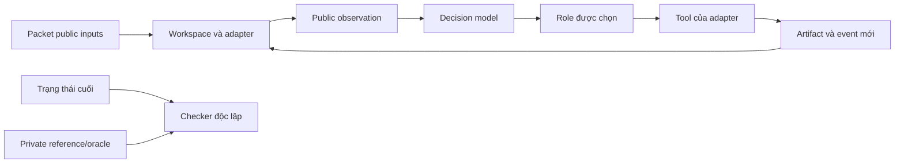

# Chuẩn mở rộng domain: packet, adapter và luồng artifact

Phiên bản tài liệu: **1.0 — 2026-11-01**. Đây là chuẩn thiết kế cho domain mới, rút từ database, code debugging và formal proof đã chạy live. Các yêu cầu dùng từ **phải** là điều kiện nghiệm thu domain mới; không có nghĩa mọi yêu cầu đã được framework tự động kiểm tra. Các khác biệt implementation hiện tại được ghi riêng, không che bằng một mô tả chung không đúng.

## 1. Mục tiêu bất biến

Tạo môi trường chung để cắm decision model và đánh giá khả năng điều phối agent giải task nhiều bước. Môi trường phải cung cấp đủ thông tin, công cụ thật, hậu quả action và checker đáng tin cậy. Không tối ưu môi trường để Jev, một executor hoặc một trajectory định sẵn đạt điểm cao bằng mọi giá.

Giữ riêng ba đối tượng: **packet** là bài toán và contract; **adapter** thực hiện cơ chế tương tác domain; **decision model** chọn role tiếp theo. Executor chỉ thực thi role đã chọn. Oracle/evaluator không tham gia routing và không tạo gợi ý giúp giải bài.

Không ép task đi qua mọi role, không auto-route/auto-STOP, không tạo thêm role chỉ để trajectory dài. Bài dễ có thể cần ít role. Nếu muốn đánh giá recovery, chọn task có cơ hội recovery thực tế hoặc khai báo cohort fault-injection riêng; không âm thầm cài lỗi để tăng số lần phối hợp.

## 2. Các lớp và đơn vị dữ liệu



| Đơn vị | Ý nghĩa và danh tính |
|---|---|
| Domain | Một loại môi trường có công cụ và task contract riêng |
| Packet | Một task, ID ổn định, source/provenance và các input có checksum |
| Episode/trajectory | Một attempt từ initial state, có run ID và packet ID |
| Decision state | Snapshot chính xác trước khi hỏi router, có decision ID |
| Action | Role hoặc STOP; role selection khác tool call |
| Artifact version | Work product/evidence có file bất biến và hash |
| Event | Hành động thực tế, kết quả, lỗi và thay đổi state |

Không ghép state/action từ hai attempt thành một trajectory. Không tái sử dụng human labels giữa run chỉ vì packet ID giống nhau.

## 3. Thiết kế packet

### 3.1. Cấu trúc và manifest

```text
packs/<domain>/<packet-id>/
  manifest.json
  public/
    task.md
    execution_contract.json
    <initial source/data/goal/reproducer>
  private/
    <oracle/reference/checker evidence>
  fixtures/
    upstream_provenance.json
    <license/non-secret static metadata>
```

Schema hiện tại: `4.2-artifact-rc1`, lớp `ArtifactManifest` trong `routing_benchmark/v4/artifacts/schema.py`. Những trường authoritative gồm `base_workflow_id`, `domain`, `task`, `adapter_id`, `public_files`, `private_files`, `fixture_files`, `source_type`, `generator_version`, `seed`, `license`, `human_review_status`, `packet_review_status`, `execution_readiness`, `metadata`.

Mỗi file entry có `artifact_id`, `path` tương đối, `media_type`, `sha256`, `visibility`. Không có đường dẫn tuyệt đối, `..`, symlink thoát pack, artifact ID trùng hoặc file không khai báo. Builder tính hash từ byte thật sau khi ghi; không điền hash ước lượng. Dùng UTF-8 rõ ràng, giữ indentation/code nguyên văn, ghi nhận chuẩn hóa newline nếu có.

`validate_artifact_pack()` hiện kiểm tra shape, checksum, path containment, file thừa và khả năng mở một số media types. Nó **không** chứng minh task giải được, không kiểm tra đầy đủ visibility policy, không xác minh semantic correctness của oracle và không thay thế runtime gate. Với source code/SQL/Lean phải gọi công cụ domain thật.

### 3.2. Task contract phải có gì

1. Mục tiêu và điều kiện cuối kiểm tra được: sửa gì, giữ gì, invariant nào phải còn đúng.
2. Trạng thái ban đầu đủ để bắt đầu: source/schema/data/goal, entrypoint và baseline/diagnostic phù hợp. Thiếu dữ liệu phải có công cụ đọc/lấy được, không chỉ giấu sau một ref không có reader.
3. Edit scope và tài nguyên: file/table/proof nào được sửa, phần nào bất biến; công cụ, runtime/toolchain, command, timeout, network policy và dependencies.
4. Contract kiểm chứng: thế nào là candidate hợp lệ, execution pass, validation pass, evidence fresh và terminal; phân biệt các mức này.
5. Visibility: router thấy gì, executor từng role thấy gì, artifact nào chỉ checker thấy, fixture nào có thể materialize.
6. Provenance: dataset/repository, commit/revision, record ID, split, license, source hash, adaptation và local verification evidence.

Không sửa kết luận/giả thiết hay xóa ca khó chỉ để executor dễ pass. Nếu cần port syntax/runtime, lưu diff và chứng minh giữ task semantics; đổi semantics tạo packet/version mới, không gọi đó là chuẩn hóa định dạng.

Reference không nhất thiết là một đáp án duy nhất: checker phải chấp nhận mọi lời giải đạt contract. Không chấm theo việc trùng exact patch/proof/role sequence của người chuẩn bị.

### 3.3. Ba trạng thái xét duyệt độc lập

- `execution_readiness`: runtime chạy được, input/context và checker đã được kiểm tra.
- `packet_review_status` / `human_review_status`: người review đã duyệt nội dung trong phạm vi nào.
- Human routing labels của **state trong run**: action nào hợp lệ; nằm ở dataset review riêng.

User cho phép chạy live không tự tạo nhãn `human_verified`. Runtime gate pass không đồng nghĩa task đã được executor giải, và private witness pass không phải performance của model. Nhãn dễ/vừa phải ghi tác giả/cơ sở; không chọn stratum theo thành tích router rồi báo như phân loại định trước.

## 4. Visibility và quyền truy cập

| Loại | Mục đích | Quy tắc cho domain mới |
|---|---|---|
| Public input | Task/source/data và thông tin cần giải | Có thể materialize; projection ra router/executor phải khai báo |
| Private oracle/reference | Kiểm chứng task cuối | Chỉ trusted checker; không vào workspace agent, prompt, artifact reader hay error message |
| Fixture | Provenance/license/static runtime metadata | **Không mặc định private**; khai báo allowlist file được materialize, kiểm tra không chứa oracle/hint |
| Runtime artifact | Candidate, diagnosis, execution và validation evidence | Tool sinh, có hash/version/dependency; công bố theo policy |
| Raw trace | Request/response/tool event phục vụ audit | Lưu độc lập; không tự truyền toàn bộ làm prompt của router kế tiếp |

**Implementation hiện tại khác nhau:** database và formal materialize public files; code external kế thừa materializer sao chép public + fixture và cần provenance để checkout repo. Vì vậy tuyệt đối không dùng tên thư mục `fixtures/` như bằng chứng oracle bị ẩn. Domain mới phải kiểm tra file thực tế trong workspace và reader, kể cả inherited implementation. `ConcreteWorkflowAdapter` là scaffolding/legacy, không phải mặc định an toàn hay bằng chứng domain đã live-ready.

Phân biệt `public_observation` với `executor_context`: router không nhất thiết thấy raw source mà executor cần. Formal hiện ẩn raw source với router nhưng render Lean nguyên văn cho executor; database dùng một public state đầy đủ cho cả hai; code dùng context phù hợp role. Bất đối xứng này phải được ghi trong contract và cố định giữa các decision model. Không tự thay visibility theo danh tính hoặc kết quả router.

Private checker có thể đọc private oracle để chấm; kết quả checker cuối không được phản hồi ngược vào episode đã thu. Private reference có trong archive tái dựng không có nghĩa agent được truy cập archive đó.

## 5. Adapter: interface và trách nhiệm

Interface authoritative ở `execution/base.py`; bản live hiện còn dùng các hook bổ sung như `configure_runtime`, `executor_context`, `versions`.

| Method/hook | Trách nhiệm |
|---|---|
| `materialize(manifest_path, workspace)` | Validate adapter/input, tạo workspace mới, chỉ copy file cho phép; không overwrite attempt cũ |
| `configure_runtime(profile)` | Gắn binary/project/dependency profile đã pin; không mang oracle vào actor context |
| `public_observation(env)` | Projection state/evidence hiện tại, không model-generated gold hoặc private labels |
| `executor_context(env, action, role_profile)` | Input đủ cho đúng role; refs phải đọc được bằng tool được cấp |
| `public_preconditions(...)` | Kiểm tra có thể thực thi sau khi action đã được chọn; trả executable + reasons |
| `tool_spec(...)` | Tên tool và schema typed đúng role identity |
| `execute_tool(...)` | Thực thi thật, cập nhật state/artifact/event, trả ToolResult và hậu quả quan sát được |
| `versions(env)` | Hash/version của input/domain state phục vụ freshness |
| `artifact_diff`, `validate_postcondition`, `terminal_status` | Diff, task/workflow contract và terminal evidence đúng version |

`ToolResult` gồm `tool_name`, `status`, `output`, `observable_message`, `cost`; `PreconditionResult` gồm `executable`, `reasons`. Structured output phải chứa evidence thật để checker/agent sau dùng được; không chỉ chuỗi “done”.

Role được cấp công cụ theo identity/contract, không suy từ từ khóa như “repair” trong mô tả. Nếu role quảng bá thực thi/verify thì phải có implementation thật tương ứng. Role phân tích chỉ tạo diagnosis/plan, không được coi văn bản đó như đã chạy tool. Tool read-only phải thực sự không ghi dữ liệu. Schema phải phân biệt text content với arguments typed như array symbol hoặc thao tác create/restore.

Tách role thành deterministic tool operation và phần cần LLM sinh work product nếu phù hợp. Một lượt role có thể có bounded reads trước work product, nhưng không được vượt sang công việc của role khác hoặc tự chọn agent tiếp theo. Số tool calls/LLM requests khác số routing actions; cần ghi riêng.

## 6. Luồng truyền artifact chuẩn

### 6.1. Handoff qua môi trường

Agent A không gửi trực tiếp một lời khẳng định cho agent B rồi coi là state thật. Luồng chuẩn:

1. Router chọn role A từ observation đã chụp.
2. Executor A đọc input/context/refs bằng các tool được cấp.
3. Tool ghi candidate/evidence thành file mới và metadata; adapter cập nhật state index.
4. Adapter tạo observation kế tiếp với artifact availability/freshness và feedback.
5. Router chọn role B; B đọc phiên bản artifact qua context/reader, thực thi công việc tiếp theo.

Chuỗi diagnosis → patch/proof → compile/test → verifier là một **khả năng**, không phải state machine bắt buộc. Routing có thể bỏ qua bước không cần thiết hoặc lặp khi có feedback mới.

### 6.2. Danh tính artifact và metadata

Phải phân biệt logical key (`candidate`, `compilation`) với immutable version. Ví dụ theo implementation database/formal:

```json
{
  "artifact_id": "candidate:3",
  "version": 3,
  "path": "_runtime/artifacts/0003_candidate.txt",
  "sha256": "<sha256 của file thật>",
  "input_versions": {"source_hash": "<hash input>"},
  "input_refs": [{"key": "diagnosis", "artifact_id": "diagnosis:2", "sha256": "<hash>"}],
  "producer_tool": "write_source",
  "producer_event": 3,
  "visibility": "public"
}
```

Đây là mẫu metadata, không phải manifest có hash hợp lệ để chạy ngay. Version hiện là chỉ số lịch sử chung, không bắt buộc là lần thứ ba của riêng logical key. Code adapter có representation khác; extension phải bảo toàn các thuộc tính provenance/freshness, không giả định mọi adapter đã dùng cùng một serializer.

File version cũ không bị ghi đè. Logical key có thể trỏ tới version mới, history giữ bản cũ. `input_versions` ghi hash của domain input; `input_refs` nối tới artifact đã đọc. Domain mới nên ghi dependency cần thiết một cách rõ ràng; không dựa vào timestamp hoặc sự tồn tại file.

### 6.3. Freshness

Evidence chỉ fresh khi các input hash/version và dependency refs mà nó kiểm tra vẫn khớp hiện tại. Viết source/SQL/patch mới không tự kế thừa validation của candidate trước. Diagnosis không chứng minh candidate đúng. Terminal phải mất hiệu lực nếu input/candidate liên quan đổi.

Candidate bị reject phải có rejected-attempt evidence riêng, không phá candidate trước đang áp dụng. Candidate mới được nhận có thể làm stale compilation/validation cũ ngay cả khi nội dung trông tương tự; những quy tắc canonicalization được chấp nhận phải công khai và log đầy đủ.

### 6.4. Artifact dài và bounded reads

Giữ nguyên file, hash, tổng độ dài và ref. Context có thể đưa preview + giới hạn hiển thị; reader phải đọc được phần còn lại chính xác, có offset/next_offset và giới hạn rõ. Kiểm tra path containment + checksum, chỉ cho đọc artifact theo allowlist, không nhận đường dẫn tùy ý dẫn tới private/host files.

Formal hiện đọc theo logical key mới nhất, tối đa 8000 ký tự/fragment; history file vẫn được lưu nhưng tool đó không cung cấp API tùy ý chọn mọi version cũ. Không hứa khả năng đọc theo artifact ID nếu adapter chưa implement. Domain mới phải ghi rõ reader lấy latest hay version cụ thể, và tránh đổi logical ref trong lúc role đang dùng nó.

Không tự dùng model khác tóm tắt hoặc sửa nội dung để “đủ context”. Nếu dùng một projection/summary có chủ đích, lưu quy tắc, provenance và dữ liệu gốc đọc được; coi đó là thay đổi môi trường khi so benchmark.

### 6.5. Chuẩn hóa representation

Có thể nhận fenced code, giữ indentation, newline chuẩn hoặc chuẩn hóa tên declaration khi task semantics không đổi. Phải ghi metadata input normalization, giữ raw response và không sửa body/giả thiết/kết luận. Formal đã có regression thực tế cho đổi riêng tên theorem; nếu các token header/context còn lại khác thì vẫn reject.

Không compile nhiều candidate do model trả rồi tự chọn cái pass nếu contract chỉ quy định chọn block cuối. Không bổ sung tactic/SQL/patch hoặc tự giải thay model trong adapter.

## 7. Hậu quả action, lỗi và recovery

Phân biệt action không thỏa precondition, output sai schema/edit contract, execution fail thật, stale evidence, model transport failure và tool/runtime unavailable. Lỗi compile/test bình thường là bằng chứng task, không mặc định lỗi hạ tầng. Timeout/giới hạn tài nguyên cần policy phân loại ghi trước; policy hiện có phải được giữ khi so model, không sửa giữa run.

Hậu quả action thất bại phải quan sát được: trạng thái trước/sau, error, artifact bị tạo/giữ lại, mutation và bước tự động nào đã diễn ra. Không auto-reset/retry semantic action rồi chỉ log kết quả tốt cuối.

Rollback do transaction/tool atomicity khác recovery do router chọn. Database có thể tự rollback savepoint khi SQL fail theo contract; phải log boundary và kết quả thật, không tính đó như một quyết định Snapshot & Rollback Operator. Role recovery chỉ được tính khi router thực sự chọn và tool create/restore thực thi. Các domain khác cũng phải phân biệt cleanup/atomic rollback với action phục hồi có chủ đích.

Retry transport có policy cố định và metadata; không phải routing mới. Nếu thiếu trace/hỏng attempt thì chạy lại với attempt ID/provenance mới, không overwrite hoặc chọn attempt pass làm đại diện mà không khai báo.

## 8. Runner, budget và scoring chung

Decision model interface: `reset(seed)`, `select(observation, candidates) -> RoutingDecision`. Candidate pool là toàn bộ role + STOP; guard tắt trong protocol đã chốt. Kiểm tra precondition xảy ra sau lựa chọn, không dùng để âm thầm masking hoặc đổi action. Probability vector, selected action và dispatch status phải giữ raw provenance.

Protocol hiện tại dùng 8 lượt non-STOP, cap output 16384/request; deterministic dispatch và precondition rejection vẫn tiêu thụ lượt. Không suy budget từ số LLM requests. Runner giữ lần hỏi cuối ở budget 0: STOP được xử lý, non-STOP ghi `suppressed_by_budget`, không thực thi và loại khỏi primary routing denominator. Không gán cho nó một tool result giả.

Task đúng không tự tạo STOP. Router có thể tiếp tục làm hỏng candidate; giữ hậu quả đó. Tách final task pass theo checker độc lập khỏi workflow + STOP pass. Thêm metric trung gian chỉ khi evidence định nghĩa rõ, không dùng role sequence reference làm gold routing.

## 9. Checker độc lập và human review

Checker dựng workspace sạch, khôi phục final deliverable và đánh giá theo task contract/trusted runtime. Code dùng checkout sạch và trusted tests; formal dùng original context, compile/kernel và allowed axioms; database dùng invariant/schema/data/query checks. Không tin riêng artifact “validation passed” do model viết.

Kết quả phải có PASS / FAIL / UNAVAILABLE hoặc tương đương đủ rõ. Báo lỗi hạ tầng và coverage riêng; không biến unavailable thành solved/unsolved bình thường. Checker cuối không sửa trajectory, không cung cấp hint cho router và không dùng private reference để áp đặt một lời giải duy nhất.

Mỗi decision state giữ task, observation đúng thời điểm, pool, budget và decision ID. Human review ẩn action hiện tại/gold đề xuất, giữ lịch sử đã quan sát. `valid_actions` có thể là một tập nhiều lựa chọn hợp lệ; chỉ nhãn xác nhận đúng run/decision mới dùng chấm action accuracy. Loại budget-suppressed khỏi denominator chính và báo coverage. Human labels được version riêng, không sửa source packet để “hoàn tất nhãn”.

## 10. Checklist tích hợp domain mới vào implementation hiện có

Không đủ nếu chỉ thêm class vào registry. Trước live cần hoàn tất:

1. Builder + source selection/provenance + manifest; chạy validate toàn bộ pack.
2. Adapter thật và role cards/tool schemas; không dùng mock/synthetic adapter làm bằng chứng live-ready.
3. `execution/registry.py`: đăng ký adapter ID/version.
4. `domain_packets/roles.py` hoặc role-card config: pool theo identity, không mượn mô tả role để cấp tool.
5. `execution/runtime.py`: resolver/profile pin runtime; provision dependencies rồi preflight thật.
6. `shared_actor.py`: bảo đảm protocol text/JSON/tool arguments/rendering tương thích executor; chưa có generic reader/codec cho mọi domain. Không nới contract chỉ để model hiện tại pass.
7. `scripts/run_shared_environment.py`: live entrypoint hiện có allowlist đúng ba adapter; domain mới cần được thêm rõ sau khi có gate, không chỉ registry.
8. Visibility projection/public event handling trong runner và adapter; hiện database có projection raw execution khác code/formal. Kiểm tra private/fixture/reader bằng test thực tế.
9. `final_evaluation.py` và evaluator dispatch: triển khai checker domain mới; unsupported hiện phải UNAVAILABLE, không trả pass mặc định.
10. Validator, preflight, export/scorer và test hooks: hiện có kiểm tra hardcoded cho ba domain/cap 16k; bổ sung coverage cần thiết trước khi tuyên bố hỗ trợ.

Giữ nguyên core loop nếu domain không cần thay đổi semantics. Nếu phải đổi interface chung, version hóa engine và regression các domain liên quan; không sửa archive đã đóng băng.

## 11. Gate nghiệm thu trước thu trajectory

| Gate | Bằng chứng tối thiểu |
|---|---|
| Source/task | Commit/hash/split/license, adaptation log, mục tiêu không bị đổi |
| Packet | Tất cả manifest valid, file mở được, metadata không giả human review |
| Runtime | Context/baseline thực chạy, toolchain/dependencies pin, command/timeout ghi rõ |
| Solvability/checker | Witness/reference hoặc evidence tin cậy; positive pass và negative reject; không expose witness |
| Role implementation | Mỗi role có tool đúng contract; read-only/mutation đúng như mô tả |
| Artifact handoff | A tạo artifact, B đọc đúng version/hash; invalid/stale/dependency đổi được phát hiện |
| Visibility | Workspace/prompt/reader/error không lộ private oracle; fixture allowlist kiểm tra thực |
| Consequences | Failure/normalization/rollback/history được log; reject không mất candidate đang dùng |
| Routing/budget | Full pool + STOP, guard policy, action rejected/STOP/budget-zero đúng accounting |
| End-to-end | Một hoặc vài smoke qua adapter + checker thật; smoke fixed sequence không tính benchmark |
| Freeze | Source/config/data/runtime IDs và checksums đã lưu; không có live changes giữa run |
| Live audit | State/action/execution join, response metadata, source freeze, independent final checker và human queue |

Gate có thể dùng witness do người chuẩn bị viết; điều đó kiểm tra môi trường, không đo executor. Native executor I/O smoke dùng cùng model có thể phát hiện rào cản representation, nhưng giữ riêng khỏi benchmark và không lọc task theo pass của router. Số sample, strata và selection policy phải chốt trước experiment.

## 12. Đóng băng và mở rộng

Release hiện tại được chỉ mục ở `benchmarks/three_domain_v1_20261101`. Gồm database 12, code 20, formal 30 packet; authoritative database reference vẫn là archive `database_v1_20261031`. Code/formal có current source snapshot, còn lịch sử run giữ snapshot/hash gốc. Không gán tất cả kết quả lịch sử thành một engine version chung.

Freeze là archive write-once có manifest/checksum và lệnh verify, không phải cấm người dùng sửa working tree. Thay packet, adapter, visibility, tool, role pool, budget, checker hoặc normalization cần release/version mới và mô tả phạm vi so sánh. Đổi decision model để đánh giá là cấu hình experiment mới, giữ environment baseline và lưu overlay rõ ràng.

Source/data bundle không tự provision Python venv, Lean/Mathlib, repository mirror hoặc provider model. Ghi runtime versions/hash/lock/path hiện có; máy mới phải provision và preflight lại. Không gọi archive đó là container hoặc bảo đảm tái lập binary nếu chưa đóng gói runtime.

Domain mới được thêm trong working tree/release kế tiếp. Giữ nguyên domain ID/packet ID/version cũ; không ghi đè archive, không regenerate historical runs. Snapshot/test evidence có trước chỉ chứng minh phạm vi nó đã kiểm tra, không tự phê duyệt domain mới.

## 13. Các lỗi thiết kế cần tránh

- Private reference đặt trong fixture rồi materialize cho agent; reader nhận arbitrary path.
- Artifact có tên mà không có nội dung/ref đọc được; role sau phải đoán trạng thái từ câu “done”.
- Lấy candidate valid làm task pass, hoặc compile pass làm proof pass dù còn sorry.
- Tái dùng validation của candidate cũ; overwrite rejected attempt lên deliverable đang áp dụng.
- Nói role “thực thi” nhưng implementation chỉ sinh prose; role được cấp tool sai vì keyword.
- Mặc định adapter base/registry entry là live-ready; quên allowlist, actor codec hoặc final evaluator.
- Ép role order, auto-correct action, giấu failure/rollback hoặc tự chọn output tốt nhất.
- Lọc bỏ task fail sau khi xem router rồi gọi đó là cohort dễ được xác định trước.
- Gộp run khác engine version/attempt hoặc chuyển human labels bằng packet ID.

Tài liệu vận hành bổ sung: `benchmark_domain_packet_completion_playbook_vi.md` quy định quy trình từ
source audit đến domain admission và benchmark freeze, lấy structured data làm reference implementation.
Các tài liệu domain gồm `code_formal_environment_design_vi.md`, `database_benchmark_protocol_vi.md` và
`formal_proof_domain_integration_vi.md`. Những mô tả visibility tổng quát trong tài liệu cũ phải được
đối chiếu với implementation, chuẩn này và completion playbook khi tạo domain mới.
