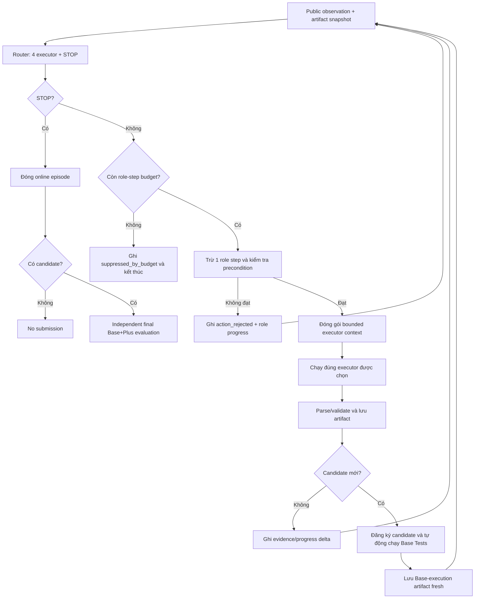

# MBPP+ protocol v6: harness và luồng thông tin

Trạng thái: **track end-to-end đã được implement**. Controlled recovery được giữ như
hướng mở rộng nhưng tạm thời không triển khai. Đọc cùng
[State, artifact và executor protocol v6](MBPP_STATE_PROTOCOL_V6_VI.md).

Mục tiêu là khắc phục stagnation và ambiguity đã quan sát trong protocol v5 nhưng vẫn
giữ bài toán nghiên cứu là dynamic executor routing, không biến router thành code agent
hoặc cho harness cứu quyết định xấu.

## 1. Vòng lặp shared harness



Base execution tự động không tạo thêm routing decision. Transport retry trong cùng
executor call không tạo thêm role step nhưng phải có request accounting riêng.

## 2. Budget và STOP

| Budget | Accounting |
|---|---|
| Role-step | Mỗi non-STOP selection tốn 1, kể cả rejected/no-op/service failure sau dispatch |
| STOP | 0 role step |
| Base execution | Tăng khi candidate source thực sự thay đổi và ở final evaluation |
| Router inference | Không tốn role step; vẫn tính model call/token/latency/cost |
| Executor request | Tính riêng với role step để audit retry/bounded reads |

Không mask action. Khi `remaining_role_steps=0`, router vẫn được hỏi:

- `STOP`: hợp lệ;
- non-STOP: ghi `suppressed_by_budget`, không gọi executor.

E3 không auto-STOP khi Base pass. Base pass chỉ là evidence chưa đầy đủ vì Plus Tests
vẫn ẩn. E1/E2 có thể giữ early-stop như policy baseline riêng; đó không phải shared
harness rule.

## 3. Preconditions

| Action | Precondition |
|---|---|
| `coder` | Luôn dispatch được |
| `logic_reviewer` | Luôn dispatch được; không code thì review specification |
| `edge_case_analyst` | Luôn dispatch được |
| `repair_agent` | Candidate tồn tại |
| `STOP` | Luôn hợp lệ |

Precondition được kiểm tra sau lựa chọn để bad routing decision vẫn quan sát được.
Khác v5, Repair trước code nên được ghi `action_rejected` thay vì gọi model rồi bỏ code;
step vẫn bị tính để không cứu router.

## 4. Information visibility

| Thông tin | Router | Executor được chọn | Base checker | Final evaluator |
|---|---|---|---|---|
| Public task contract | Có | Có | Có | Có |
| Candidate preview/hash/version | Có, bounded | Có; full nếu vừa cap | Full source | Full source cuối |
| Capability card toàn pool | Có | Chỉ role hiện tại | Không | Không |
| Remaining routing budget | Có | Không mặc định | Không | Không |
| Fresh Base artifact | Public projection | Automatic handoff | Tạo artifact | Không feed ngược |
| Review/edge artifacts | Metadata/projection | Latest fresh content | Không | Không |
| Stale artifact | Metadata/freshness | Không có content mặc định | Không | Không |
| Recent semantic events | Bounded | Progress liên quan | Không | Không |
| Router confidence/raw reasoning | Router adapter/log | Không | Không | Không |
| Raw executor response | Không | Không tự truyền | Không | Audit only |
| Base raw tests/expected/actual | Không | Không | Private | Private |
| Plus tests/result | Không | Không | Không online | Private, final-only |

Việc artifact đã được giao không chứng minh model đã sử dụng artifact. Request log phải
ghi messages và delivered-evidence refs thật để audit.

## 5. Automatic artifact handoff

Mỗi executor call dựng context mới; không có shared chat memory. Kênh bàn giao duy nhất
là state/artifact đã version hóa.

Context packer:

1. lấy task, candidate ref và fresh evidence;
2. tạo role-specific projection;
3. gắn artifact ID/hash/input refs/freshness;
4. giữ critical fields trước prose;
5. đo token bằng tokenizer của executor;
6. trim deterministic nếu vượt cap;
7. ghi delivered-evidence manifest cùng request.

Không dùng LLM để tóm tắt evidence. Không truyền raw conversation hoặc chain-of-thought
của executor trước.

## 6. Candidate transition và Base evaluator

Sau code-producing action:

1. parse complete Python artifact;
2. kiểm tra entry point và output contract;
3. tính raw hash và presentation fingerprint;
4. nếu exact source không đổi: ghi duplicate/no-progress, không chạy Base;
5. nếu source đổi: đăng ký candidate version mới;
6. tự động chạy full Base suite;
7. lưu raw result private và public Base-execution artifact đã làm sạch;
8. recompute freshness cho review/analysis artifacts.

Current candidate luôn là output hợp lệ gần nhất đã được nhận, kể cả Base score giảm.
Không rollback, không best-of-history và không thử nhiều block rồi chọn block pass.

## 7. Feedback policy

Nên có hai policy được pin trong config:

| Policy | Public evidence |
|---|---|
| `counts_only_v1` | Status và passed/total như v5 |
| `sanitized_diagnostic_v2` | Counts + failure kind/signature + exception/location đã làm sạch |

Mọi router trong cùng experiment phải dùng cùng policy. Richer feedback là một biến
thực nghiệm độc lập; không được đổi riêng cho một router. Plus evidence không xuất hiện
ở cả hai policy.

## 8. Final evaluation

Khi online episode kết thúc:

- không candidate: no submission, không fabricate evaluation;
- có candidate: evaluator độc lập chạy Base+Plus đúng một lần trên current source;
- final result không quay lại state;
- raw Plus result chỉ vào private log;
- workflow success và code quality phải báo cáo tách khỏi service reliability.

Final evaluator phải pin EvalPlus version, dataset hash, OS/evaluator backend và
`fast_check=false`. Final Base có thể khác online Base chỉ khi có lỗi hạ tầng hoặc
protocol violation; trường hợp đó phải được phân loại riêng.

## 9. Error và termination taxonomy

Termination chính:

- `router_stop`;
- `router_stop_no_submission`;
- `suppressed_by_budget`;
- `wall_time_exhausted`;
- `router_service_error`;
- `executor_service_error` nếu policy fail-fast;
- baseline-specific: `base_passed`, `fixed_rounds_complete`.

Action result status:

- `ok_artifact`;
- `ok_no_change`;
- `action_rejected`;
- `generation_failure`;
- `contract_failure`;
- `executor_service_failure`;
- `base_tool_failure`;
- `context_budget_exceeded`.

Một infrastructure failure có thể cùng tồn tại với final success. Báo cáo quality không
được thay thế báo cáo reliability.

## 10. Logging đã triển khai

```text
runs/<run_name>/<run_id>/
  config.json
  manifest.json
  metrics.json
  episodes/<task_id>/
    state_snapshots.jsonl
    decisions.jsonl
    trajectory.jsonl
    requests.jsonl
    result.json
    private_final_eval.json
    artifacts/
      0001_candidate.py
      0002_base_execution.json
      ...
```

Public export loại private tests/results và raw secrets. `requests.jsonl` cần redact API
credential nhưng giữ exact message payload, token accounting và delivered evidence.

## 11. Hai evaluation track

### 11.1 End-to-end dynamic routing

- State bắt đầu chưa có candidate.
- Router có toàn quyền chọn analysis, code, repair hoặc STOP.
- Đo final Plus, no-submission, time-to-first-code, action quality và efficiency.
- Recovery opportunity set có thể khác giữa method; phải báo denominator riêng.

### 11.2 Controlled recovery routing — tạm hoãn

- Sinh và freeze một initial candidate cho mỗi task bằng cùng Coder config.
- Chạy Base và freeze initial Base artifact.
- Chỉ giữ các task initial Base-fail làm recovery bank, hoặc báo cả bank với flag.
- Mọi router bắt đầu từ cùng candidate, evidence, budget và action space.
- Đo exact recovery, partial Base delta, final Plus, calls-to-recovery và stagnation.

Track này cô lập router tốt hơn so với so recovery từ các lời giải đầu khác nhau. Frozen
candidate bank cần hash manifest, source snapshot và evaluator provenance.

### 11.3 Cohort rerun hiện tại

Implementation hiện chỉ chạy track 11.1. Full 378 task được phân hoạch để quản lý run
thành cohort hậu nghiệm A (124 task JEV và Luna cùng fail final Plus ở v5) và cohort B
(254 task còn lại). Hai cohort rời nhau và hợp đúng full manifest. Đây không phải
controlled recovery: mỗi method vẫn bắt đầu từ empty state và tự sinh trajectory riêng.
Không dùng riêng cohort A để suy rộng performance; báo cáo cohort-wise hoặc ghép hai
cohort của cùng method/protocol để tái tạo full 378.

## 12. Metrics bắt buộc

Quality:

- final Base/Plus task pass;
- tổng Base/Plus test pass;
- Base recovery và regression;
- partial test improvement;
- recovered-and-Plus-pass.

Routing/progress:

- action distribution theo state;
- rejected/suppressed/no-op rate;
- duplicate candidate và consecutive no-progress;
- fresh/stale evidence availability và utilization;
- semantic-delta rate theo role;
- marginal recovery theo step/round;
- STOP calibration theo terminal/evidence state.

Efficiency/reliability:

- role steps, router/executor requests, token, latency, Base executions;
- context truncation/refusal;
- router/executor service failures;
- final evaluation availability.

## 13. Những phần không chuyển từ formal-proof sang MBPP+

- Không thêm Compiler/Verifier/Inspector vào action space; Base evaluator là automatic
  deterministic transition.
- Không cần runtime cohort Lean/Mathlib; chỉ pin Python, EvalPlus và checker backend.
- Không cần artifact read tool cho code MBPP thông thường; bounded full-source handoff
  đủ dùng. Chỉ bổ sung fragment read nếu source thực tế vượt cap.
- Không có immutable theorem statement edit scope, nhưng vẫn phải giữ task/entry point
  bất biến.
- Không dùng proof witness; tương đương private reference là Plus/canonical data và vẫn
  bị cô lập hoàn toàn.

## 14. Migration từ v5

1. Giữ nguyên code/config/run v5; không reinterpret log cũ thành artifact v6.
2. Thêm dataclass artifact, candidate identity, freshness và role progress.
3. Tách internal authoritative state khỏi router/executor projection.
4. Thêm context packer có tokenizer cap và delivered-evidence log.
5. Thêm feedback policy v2 và failure taxonomy.
6. Chuyển flat run log sang episode artifact log hoặc cung cấp compatible exporter.
7. Thêm regression tests cho privacy, freshness, duplicate và zero-budget behavior.
8. Tạo protocol/config name mới, ví dụ `v6-artifact-state-sanitized-feedback`.
9. Chạy pilot end-to-end trên cùng manifest trước khi chạy lại full MBPP+.

Không so trực tiếp run v5 và v6 như thể chỉ router thay đổi; state, feedback và executor
context đã thay đổi. Nếu cần attribution, chạy ablation theo từng thay đổi protocol.
